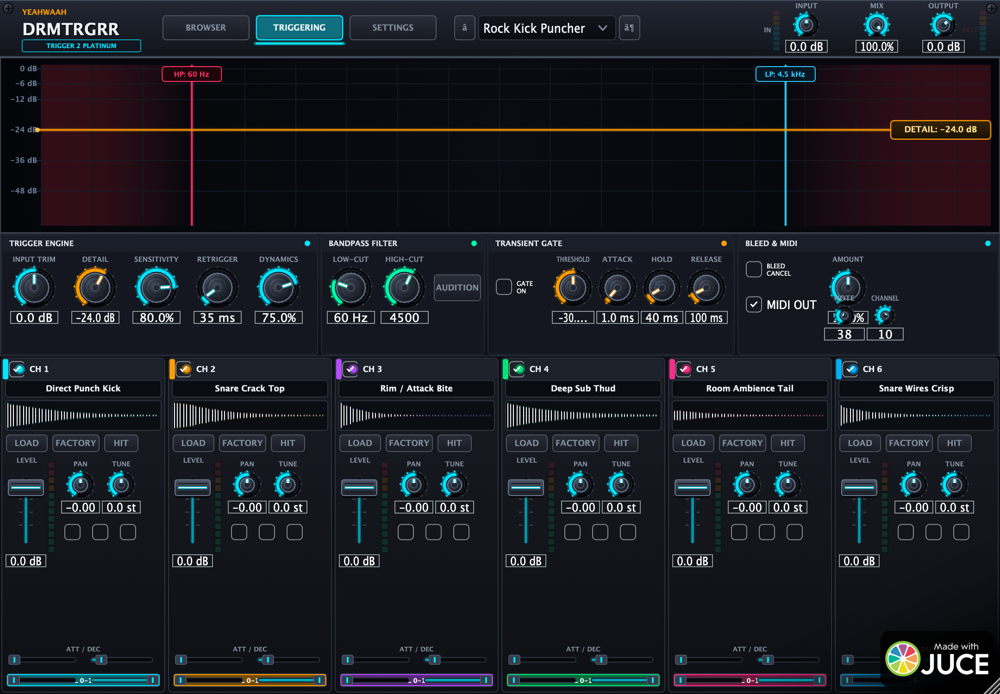

# DRMTRGRR by yeahwaah

**DRMTRGRR** is an ultra-precise, low-latency drum replacement and transient triggering audio plugin built in C++ using the JUCE framework. Available as **VST3**, **AU**, and **Standalone** on **macOS** and **Windows**.

Inspired by the industry-standard workflow and aesthetic of Slate Digital Trigger 2, **DRMTRGRR** brings a dark brushed-slate analog interface, real-time transient oscilloscope visualization, interactive draggable threshold detection, multi-slot drum sample layering, transient-driven gating, crosstalk leakage suppression, and full MIDI I/O.

<p align="center">
  
</p>

---

## Key Features & Slate Trigger 2 Comparison

| Feature | Slate Digital Trigger 2 | DRMTRGRR (yeahwaah) |
|---|---|---|
| **Oscilloscope Waveform Display** | Real-time scrolling transient visualizer | Real-time scrolling transient oscilloscope with gradient glow |
| **Interactive Threshold** | Visual Detail line across waveform | Draggable amber **DETAIL** line with direct mouse control & readout |
| **Transient Indicators** | Visual flags on hits | Neon trigger lines & velocity tracking indicators on hits |
| **Transient Detection Filter** | Bandpass (HP/LP) with Audition Listen | Dual Biquad High-Pass + Low-Pass with amber **LISTEN** audition mode |
| **False-Trigger Prevention** | ReTrigger lockout timer (ms) | Lockout timer (5 - 500 ms) preventing ringing / double hits |
| **Dynamic Response** | Sensitivity & Dynamics curves | Sensitivity (0-100%) and Dynamics velocity scaling (0-100%) |
| **Bleed Suppression** | Leakage suppression engine | Differential energy leakage & crosstalk cancel engine |
| **Source Audio Gate** | Transient-driven gate (Attack/Hold/Release) | Fast transient-driven noise gate on original mic signal |
| **Drum Sample Layers** | Multi-slot sample rack | Up to 6 simultaneous sample slots (Direct, Sub, Rim, Room, Snare Wires, etc.) |
| **Slot Playback Controls** | Volume, Pan, Tune, Solo, Mute, Phase Flip | Volume fader (-60 to +12dB), Pan, Tune (±24 semitones), Solo, Mute, Phase Invert (ø) |
| **Envelopes & Velocity Mapping**| Attack, Decay, Min/Max Velocity | Per-slot Attack (0.1-50ms), Decay (10-2000ms), Min & Max Velocity windows |
| **Factory Drum Generator** | Built-in sample kit | Built-in synthesized studio drum sounds for immediate playback without external files |
| **Sample Loading** | WAV / AIFF / Custom files | Drag-and-drop & file chooser support for WAV, AIFF, MP3, FLAC |
| **MIDI Output & Input** | Sends MIDI notes, triggers via MIDI | Full MIDI Out (configurable note & channel) + MIDI In triggering |
| **Dry / Wet & Master** | Mix blend & Output Level | Dry/Wet blend (0-100%) + Output Gain + Studio Soft-Saturation Limiter |

---

## Graphical Interface Layout

```
+-----------------------------------------------------------------------------------------------+
|  YEAHWAAH        DRMTRGRR                      [ Preset Dropdown ]   IN [::]  MIX ( )  OUT ( )|
+-----------------------------------------------------------------------------------------------+
|  OSCILLOSCOPE WAVEFORM VISUALIZER                                                             |
|  0 dB  -------------------------------------------------------------------------------------  |
|  -12dB -------------------------------------------------------------------------------------  |
|  -24dB ======================== [ DETAIL: -24.0 dB (Draggable) ] ===========================  |
|  -48dB -------------------------------------------------------------------------------------  |
|        [Waveform History with Cyan Glow Fill]     | HIT (Flash)                               |
+-----------------------------------------------------------------------------------------------+
|  TRANSIENT ENGINE        | BANDPASS FILTER   | TRANSIENT GATE           | BLEED & MIDI        |
|  (Trim) (Detail) (Sens)  | (Lo-Cut) (Hi-Cut) | [GATE] (Thresh) (Att)    | [BLEED] (Amount)    |
|  (Retrig) (Dynamics)     | [LISTEN]          | (Hold) (Rel)             | [MIDI OUT] (Note/Ch)|
+-----------------------------------------------------------------------------------------------+
|  SLOT 1: Kick Direct     | SLOT 2: Snare Top | SLOT 3: Rim / Bite       | SLOT 4: Room ...    |
|  [Wave Preview]          | [Wave Preview]    | [Wave Preview]           | [Wave Preview]      |
|  [LOAD] [FACTORY] [HIT]  | [LOAD] [FACTORY]  | [LOAD] [FACTORY] [HIT]   | [LOAD] [FACTORY]    |
|  [|] Vol Fader + LED     | [|] Vol Fader     | [|] Vol Fader            | [|] Vol Fader       |
|  (Pan) (Tune) [S][M][ø]  | (Pan) (Tune)      | (Pan) (Tune)             | (Pan) (Tune)        |
|  Att/Dec | Vel Range     | Att/Dec | Vel     | Att/Dec | Vel            | Att/Dec | Vel       |
+-----------------------------------------------------------------------------------------------+
```

---

## Supported Formats & Platforms

- **macOS**:
  - Formats: **VST3**, **AU (Audio Unit)**, **Standalone (.app)**
  - Architectures: **Universal Binary** (Apple Silicon `arm64` + Intel `x86_64`)
  - Tested on macOS 13, 14, 15+

- **Windows**:
  - Formats: **VST3**, **Standalone (.exe)**
  - Architecture: **x64** (Visual Studio 2022 MSVC)
  - Tested on Windows 10 & 11

---

## Building from Source

### Prerequisites

- **CMake** 3.22 or higher
- C++17 compatible compiler (Clang on macOS, MSVC 2022 on Windows)
- (Optional) **Ninja** build system

### 1. macOS Build

```bash
# Clone the repository with submodules (JUCE is included in libs/JUCE)
git clone --recursive <repo-url>
cd drum-trigger

# Configure and compile using CMake & Ninja
cmake -B build -G "Ninja" -DCMAKE_BUILD_TYPE=Release
cmake --build build --config Release --parallel
```

Compiled plugin outputs on macOS:
- **VST3**: `build/DRMTRGRR_artefacts/Release/VST3/DRMTRGRR.vst3`
- **AU**: `build/DRMTRGRR_artefacts/Release/AU/DRMTRGRR.component`
- **Standalone**: `build/DRMTRGRR_artefacts/Release/Standalone/DRMTRGRR.app`

To install on macOS:
```bash
# Copy VST3 to system VST3 directory
cp -R build/DRMTRGRR_artefacts/Release/VST3/DRMTRGRR.vst3 ~/Library/Audio/Plug-Ins/VST3/

# Copy AU to system Components directory
cp -R build/DRMTRGRR_artefacts/Release/AU/DRMTRGRR.component ~/Library/Audio/Plug-Ins/Components/
```

### 2. Windows Build

Open Developer Command Prompt for Visual Studio 2022:

```bat
git clone --recursive <repo-url>
cd drum-trigger

cmake -B build -G "Visual Studio 17 2022" -A x64
cmake --build build --config Release --parallel
```

Compiled plugin outputs on Windows:
- **VST3**: `build/DRMTRGRR_artefacts/Release/VST3/DRMTRGRR.vst3`
- **Standalone**: `build/DRMTRGRR_artefacts/Release/Standalone/DRMTRGRR.exe`

To install on Windows:
Copy `DRMTRGRR.vst3` to `C:\Program Files\Common Files\VST3\`.

---

## Automated CI/CD (GitHub Actions)

The repository includes a continuous integration workflow (`.github/workflows/build.yml`) that triggers on every push and pull request. It automatically compiles both:
1. **Windows 2022 x64** VST3 & Standalone binaries
2. **macOS Universal** VST3, AU, and Standalone app binaries

And attaches them as downloadable release artifacts!

---

## Presets Included

1. **Rock Kick Puncher**: Tuned for punchy kick drums with low-end weight and fast transient response.
2. **Modern Snare Crack**: Isolates snare fundamental and crack wires, filtering high-hat bleed.
3. **Fat Snare 80s**: Deep body with blended natural room ambience and gated tail.
4. **Metal Tom Thumper**: Tight transient response with aggressive leakage suppression.
5. **Acoustic Natural Kit**: 50/50 Dry/Wet blend with transient gate for natural sound reinforcement.
6. **Ghost Note Hunter**: High sensitivity and ultra-fast retrigger to catch delicate snare ghost notes.

---

## License

Developed by **yeahwaah**. All rights reserved.
Built with the JUCE framework.
